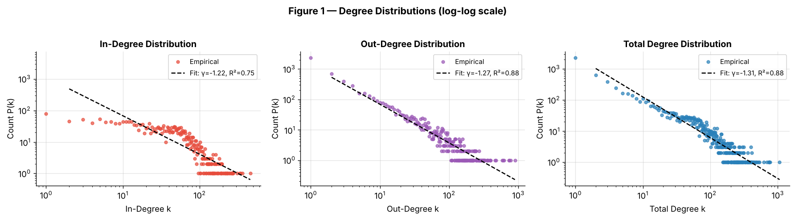
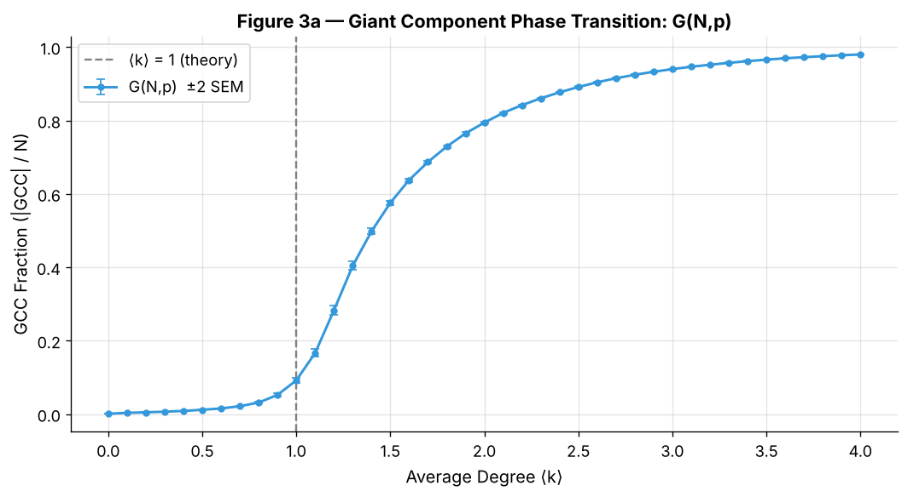
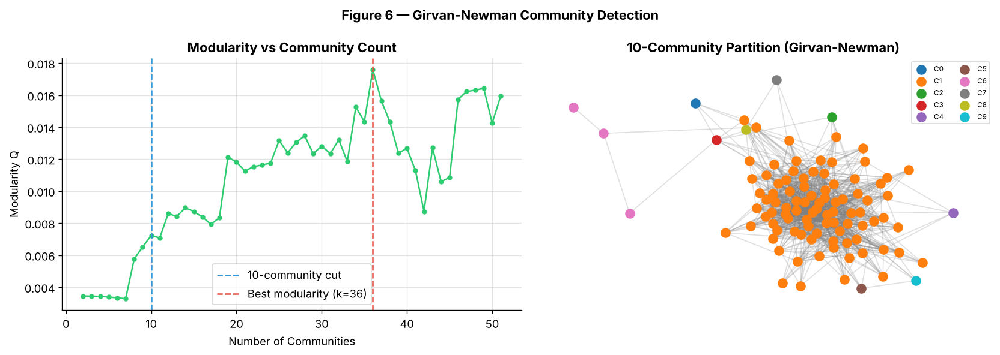
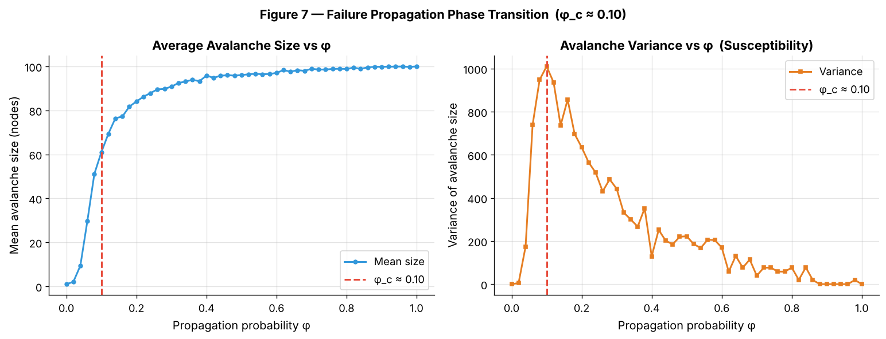
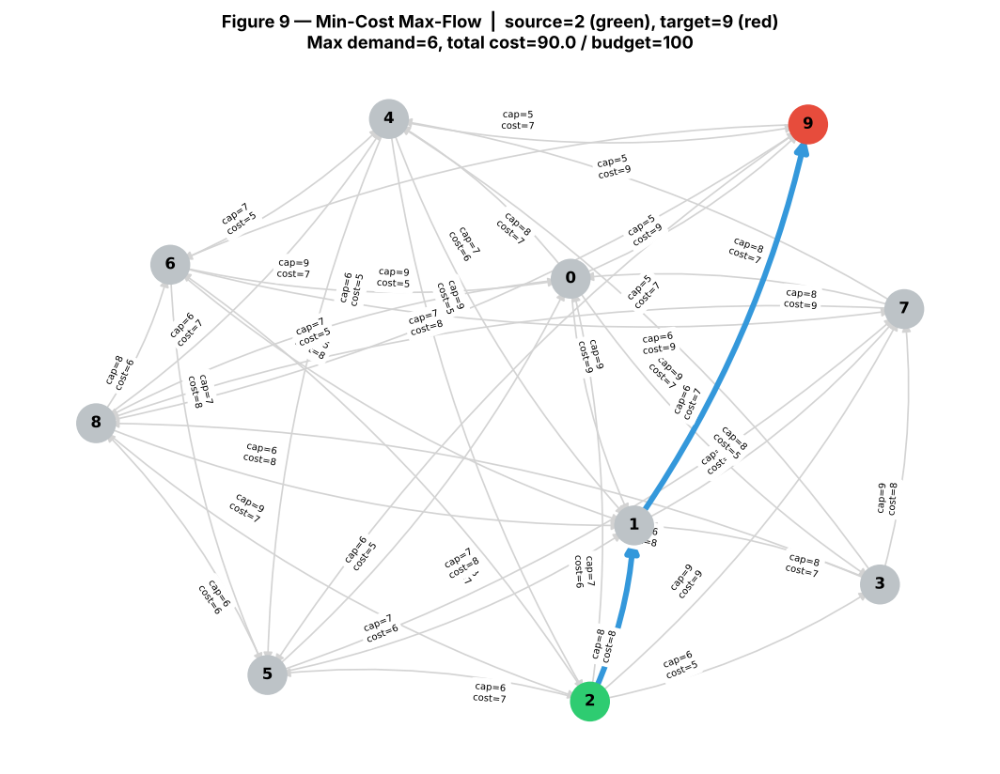

# 🕸️ Network Science: The Wikipedia Adminship Voting Network

> An end-to-end network analysis of who votes for whom in Wikipedia administrator elections: structure, influence, random-graph theory, communities, cascading failures, opinion dynamics and flow optimisation. Built in Python with NetworkX.


**Data:** [Stanford SNAP Wikipedia Vote Network](https://snap.stanford.edu/data/wiki-Vote.html). **7,115 users** and **103,689 directed votes**, where an edge A → B means user A voted on user B's adminship request.

---

## 📌 Key findings

| Analysis | Result |
|---|---|
| **Connectivity** | 99.3% of users sit in one weakly connected component (7,066 users), but only 18.3% are in the giant *strongly* connected component (1,300 users). Voting is mostly one-way: being voted for rarely means voting back. |
| **Influence is concentrated** | Votes received and votes cast are both heavy-tailed. One user received 457 votes and one cast 893, while most users have only a handful. |
| **Different "most important" users** | On the giant SCC, eigenvector centrality, PageRank, betweenness and closeness each pick a **different** top user, so "influence" depends on how you measure it. |
| **Random-graph phase transition** | In G(N, p) the giant component stays near zero below average degree ⟨k⟩ = 1 and then rises steeply, passing 50% at ⟨k⟩ ≈ 1.4, matching Erdős–Rényi theory. G(N, L) gives the same transition with lower variance. |
| **Weak community structure** | In a 100-user hub sample, Girvan–Newman's best partition has modularity of only **0.018**, so there are almost no tight voting blocs. Votes reflect judgements about candidates, not group loyalty. |
| **Fragile to cascades** | Cascading failures go network-wide at a propagation probability of only **φ_c ≈ 0.10**, where an average cascade already reaches 61 of the 100 nodes. |
| **Opinion dynamics** | In a 3-opinion voter model on a dense random graph, no consensus forms within 500 timesteps: shares stay near one-third each (0.30 / 0.33 / 0.37). |
| **Flow optimisation** | In a 10-node network with a budget of 100, at most **6 units** can be delivered (cost 90), limited by one bottleneck edge at full capacity. |

---

## 📊 Selected charts

**Heavy-tailed degree distributions** (log-log scale)



**Giant component phase transition in G(N, p)** (200 realisations per point, ±2 SEM)



**Community detection on the hub subnetwork**



**Cascading failures.** The variance peak marks the critical point φ_c.



**Minimum-cost flow within budget**



All 10 figures are in the repository root (`fig1` … `fig9`).

---

## 🔬 What the notebook covers

| Part | Topic | Techniques |
|:---:|---|---|
| 1 | Structural analysis | SCC/WCC decomposition, degree distributions, log-log fits, four centrality measures |
| 2 | Random graph phase transitions | G(N, p) and G(N, L) models, percolation threshold, bootstrapped error bars; path length and diameter on disconnected networks |
| 3 | Biased random-walk sampling | Eigenvector-centrality-weighted 100-node subgraph |
| 4 | Community detection | Girvan–Newman, modularity curve, assortativity |
| 5 | Failure propagation | Cascade model, critical point from the variance peak |
| 6 | Opinion dynamics | 3-opinion voter model, disagreement over time |
| 7 | Flow optimisation | Min-cost flow (network simplex), budget-constrained maximum demand |

Part 2 includes an assignment task that asked students to **critically evaluate an AI-generated answer** (from ChatGPT) about measuring distances on disconnected networks. The notebook quotes the answer and assesses where it is and isn't correct.

## 🗂️ Repository structure

```
Network-Science-Project/
├── network_science_portfolio.ipynb   # full analysis, all 7 parts (with outputs)
├── wikivote.txt                      # SNAP edge list (7,115 nodes, 103,689 edges)
├── fig1_…png – fig9_…png             # figures generated by the notebook
├── requirements.txt
└── README.md
```

## ▶️ How to run

```bash
git clone https://github.com/abir110/Network-Science-Project.git
cd Network-Science-Project
pip install -r requirements.txt
jupyter lab network_science_portfolio.ipynb
```

Run all cells. A full run takes around **10 minutes**, mostly the 200-realisation phase-transition sweep and the 500-trial cascade simulations. All randomness is seeded, so results are reproducible.

## ⚠️ Notes

- The degree-distribution slopes come from a least-squares fit on log-log frequencies. That shows a heavy tail, but it is not a formal power-law test.
- Parts 3–5 run on a 100-user sample drawn by a hub-biased random walk, so their results describe the well-connected core of the network rather than all of it.

## 📚 References

- Leskovec, J., Huttenlocher, D. & Kleinberg, J. (2010). Signed networks in social media. *CHI 2010.* (dataset)
- Barabási, A.-L. (2016). *Network Science.* Cambridge University Press.
- Erdős, P. & Rényi, A. (1960). On the evolution of random graphs. *Publ. Math. Inst. Hung. Acad. Sci.*, 5, 17–61.
- Girvan, M. & Newman, M. E. J. (2002). Community structure in social and biological networks. *PNAS*, 99(12), 7821–7826.

---

**Author:** Abir Alam Srabon · MSc Data Science, Aston University · Completed for the *AM41NS Network Science* module
[LinkedIn](https://www.linkedin.com/in/abir-alam-srabon) · [GitHub](https://github.com/abir110) · [Portfolio](https://abir110.github.io)
